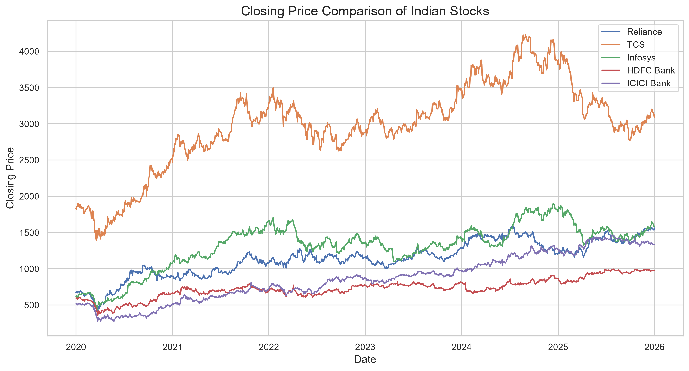
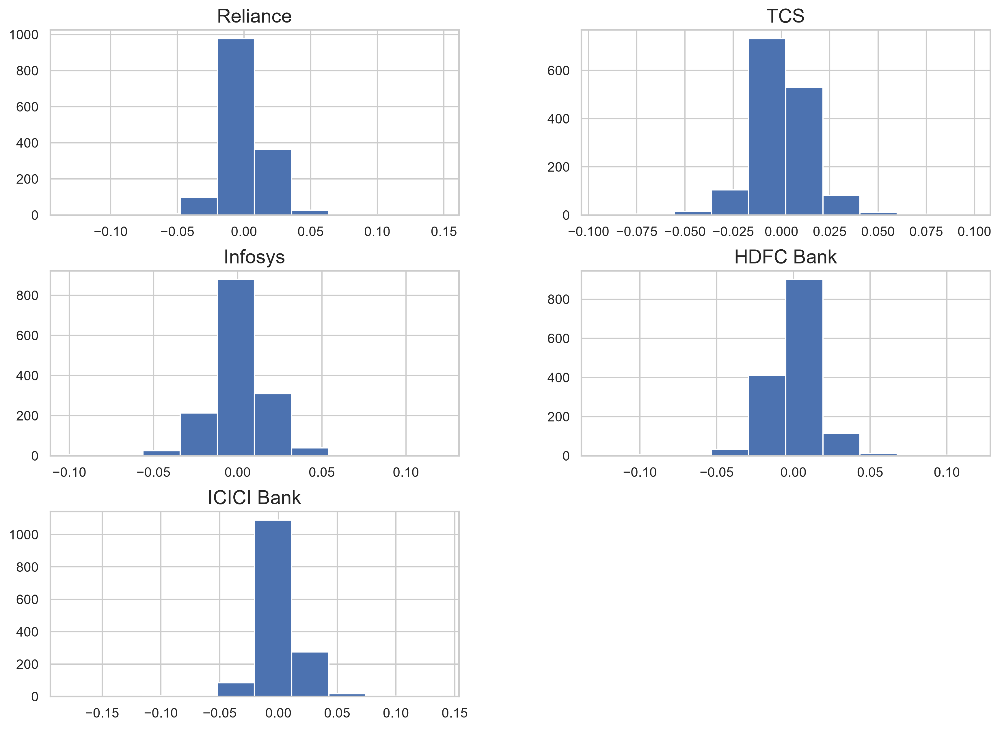
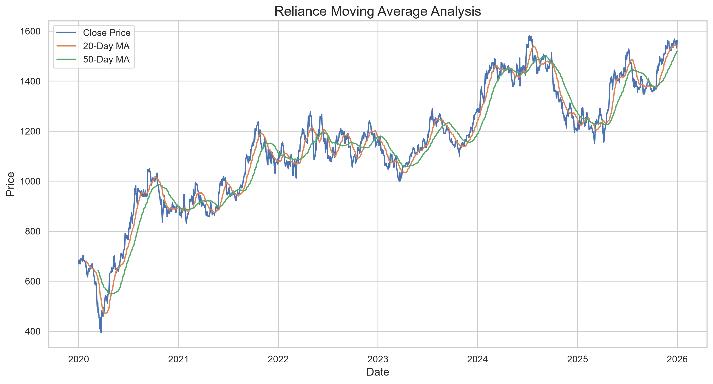
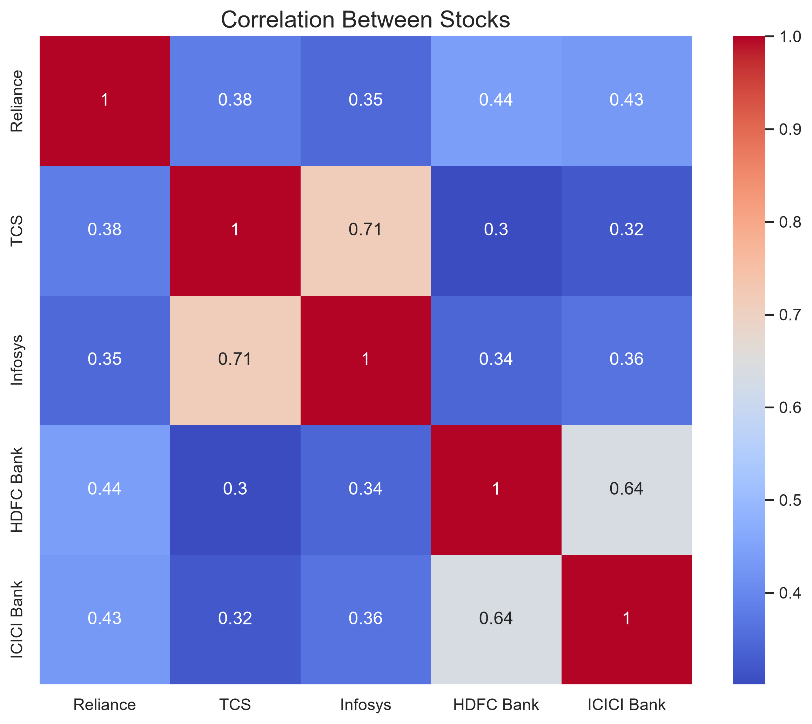
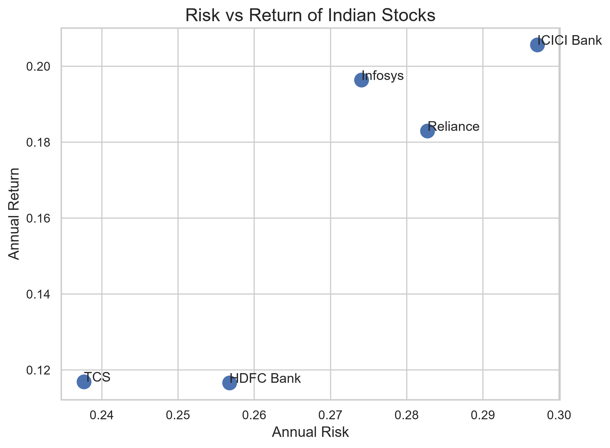

[](https://github.com/kshitiz567/indian-stock-market-analysis)
[](https://colab.research.google.com/github/kshitiz567/indian-stock-market-analysis/blob/main/notebooks/stock_analysis.ipynb)
# 📈 Indian Stock Market Analysis

<p align="left">
  
  
  
  
  
  
  
</p>

## 📌 Project Overview

The objective of this project is to analyze the historical stock prices of leading Indian companies and identify trends, returns, volatility, and relationships between different stocks.

The analysis includes:

- Historical Closing Price Analysis
- Daily Return Analysis
- Moving Average Analysis
- Correlation Analysis
- Risk vs Return Analysis
- Overall Performance Comparison

---

## 🏢 Companies Analyzed

- Reliance Industries
- Infosys
- TCS (Tata Consultancy Services)
- HDFC Bank
- ICICI Bank

---

## 🛠️ Tech Stack

- Python
- Pandas
- NumPy
- Matplotlib
- Seaborn
- yFinance
- Jupyter Notebook

---

## 📂 Project Structure

```
Indian-Stock-Market-Analysis/
│
├── data/
│   ├── reliance.csv
│   ├── infosys.csv
│   ├── tcs.csv
│   ├── hdfc_bank.csv
│   └── icici_bank.csv
│
├── images/
│   ├── closing_price_comparison.png
│   ├── correlation_heatmap.png
│   ├── daily_returns.png
│   ├── moving_average.png
│   ├── reliance_closing_price.png
│   └── risk_vs_return.png
│
├── notebooks/
│   └── stock_analysis.ipynb
│
├── README.md
├── LICENSE
├── requirements.txt
└── .gitignore
```

---

## 📊 Analysis Performed

### 📈 1. Stock Closing Price Analysis

Visualized historical closing prices to understand long-term market trends.

--

### 📉 2. Daily Returns

Calculated percentage change in stock prices to measure daily performance and volatility.

---

### 📊 3. Moving Average

Applied moving averages to smooth price fluctuations and identify long-term trends.

---

### 🔥 4. Correlation Heatmap

Analyzed how different stocks move relative to one another.

---

### ⚖️ 5. Risk vs Return

Compared expected returns with associated risks to evaluate investment opportunities.

---

### 🏆 6. Overall Performance Comparison

Compared cumulative returns across all selected companies.

---

# 📷 Project Visualizations

## Closing Price Comparison



---

## Daily Returns



---

## Moving Average



---

## Correlation Heatmap



---

## Risk vs Return



---

# 📌 Key Insights

- Reliance showed strong long-term growth during the selected period.
- Banking stocks displayed relatively stable price movements.
- Technology stocks experienced higher volatility.
- Some stocks exhibited strong positive correlations.
- Risk and return varied significantly across sectors.

---

# 🚀 How to Run the Project

### Clone the repository

```bash
git clone https://github.com/kshitiz567/indian-stock-market-analysis.git
```

### Move into the project folder

```bash
cd indian-stock-market-analysis
```

### Install dependencies

```bash
pip install -r requirements.txt
```

### Launch Jupyter Notebook

```bash
jupyter notebook
```

Open:

```
notebooks/stock_analysis.ipynb
```

---

# 📚 Future Improvements

- Add more Indian companies
- Include NIFTY 50 index comparison
- Build an interactive dashboard using Plotly
- Perform portfolio optimization
- Apply machine learning for stock price prediction

---

# 👨‍💻 Author

**Kshitiz Goyal**

Aspiring Data Analyst- Python, Excel & PowerBI
---

# ⭐ If you found this project helpful

Please consider giving this repository a ⭐ on GitHub.

It motivates me to build more data analysis and machine learning projects.
